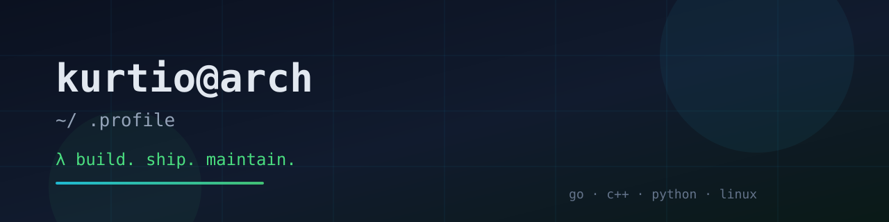

# Hi，I'm kurtio 👋

  

> 一名写了十几年代码的老程序员，喜欢把系统折腾到"刚好顺手"的状态。

## 关于我

- 🧑‍💻 全栈 / 后端 / 嵌入式都碰过的工程师，日常在 **Arch Linux** 上工作
- 🐧 Linux 重度用户：从内核参数、systemd 单元到输入法框架，能自己改的尽量自己改
- 🔧 喜欢工业物联网、逆向工程、自托管服务，以及一切"能跑在自己机器上"的东西
- 🎮 偶尔写点游戏相关的小工具，也玩 Minecraft / 泰拉瑞亚
- 📚 相信**可维护性 > 花哨**，文档和脚本要能交给下一个人接手

## 技术栈

**语言**

**平台与工具**

**方向**

- 后端服务与 API 设计（Go / Python）
- 工业设备接入与协议解析（串口、Modbus、TCP/UDP 采集）
- 嵌入式与系统级调试（交叉编译、驱动、刷机）
- 前端脚本与自动化（浏览器插件、数据导出、CI 流水线）

## 正在做什么

- 🔭 正在打磨一套自托管的家庭服务栈（监控、备份、内网穿透）
- 🌱 正在学习：Rust 异步运行时、更规范的 Go 项目分层
- 🎯 当前目标：把散落的脚本整理成可复用的小工具集，并补齐测试
- 🤝 可接受的合作：开源工具维护、协议解析 / 数据采集类需求、Linux 环境排障

## 项目

- [project-one](https://github.com/kurtio/project-one) — 一个示例项目占位，替换成你的真实仓库
- [project-two](https://github.com/kurtio/project-two) — 另一个示例项目占位

> 建议只保留**真实存在**的仓库链接，避免 README 出现死链。

## GitHub 统计

  
  

<!-- STATS:START -->
| 指标 | 数值 |
| --- | --- |
| 账号 | @kurtio |
| 公开仓库 | 2 |
| 关注者 | 0 |
| 注册时间 | 2026-11-26 |

_更新于 2026-11-27 01:25（UTC+8）_
<!-- STATS:END -->

## 联系方式

- Email：`kurtio@users.noreply.github.com`（占位，请换成你愿意公开的邮箱）
- Website：https://kurtio.github.io
- GitHub：[@kurtio](https://github.com/kurtio)

---

本仓库使用 [MIT License](LICENSE)。README 中不包含任何密码、密钥、Token、住址或私人邮箱。
